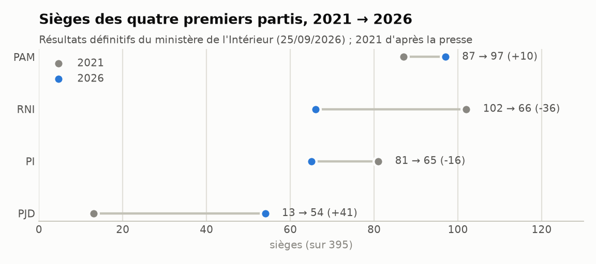
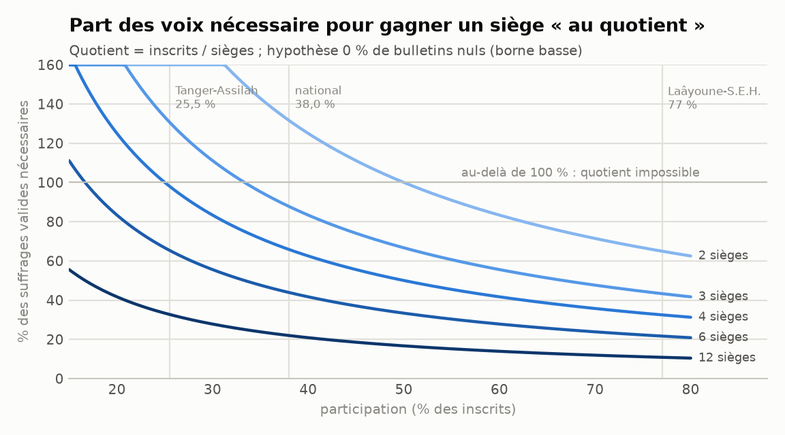
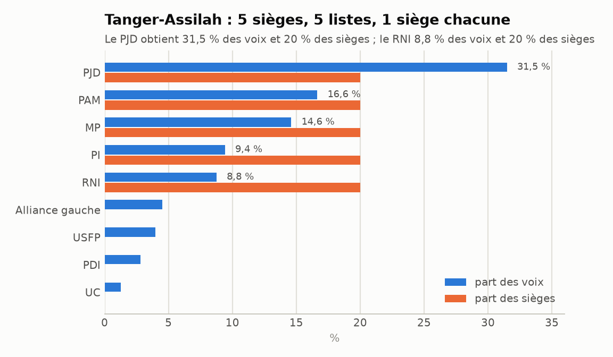
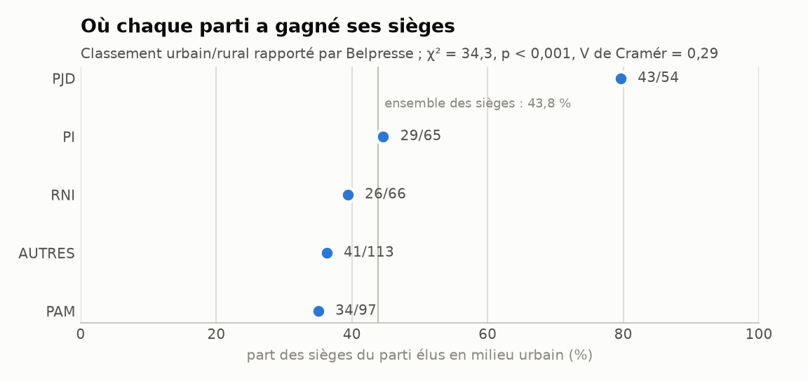
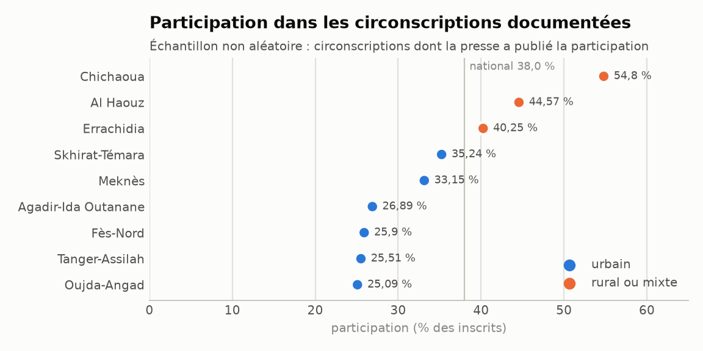

# Audit indépendant : opinion politique en ligne et législatives marocaines du 23 septembre 2026

**Date de rédaction :** 26 septembre 2026 (trois jours après le scrutin) ; mise à jour le même jour à 10 h UTC (échantillon de circonscriptions élargi de 15 à 33).
**Statut :** rapport intermédiaire. Le volet « réseaux sociaux » n'a **pas** pu être réalisé (voir encadré).
**Position :** ce rapport ne soutient ni n'attaque aucun parti. Il ne suppose ni fraude, ni absence de fraude.

> **À lire d'abord : ce que ce rapport contient et ne contient pas**
>
> 1. **Aucun commentaire en ligne n'a pu être collecté.** L'environnement technique dans lequel l'audit a été mené bloque l'accès réseau à Facebook, TikTok, YouTube, Instagram, X, Reddit et à tous les sites de médias marocains testés (plus de 60 hôtes testés, tous refusés hormis les dépôts de logiciels ; voir [`data/acces_plateformes.csv`](data/acces_plateformes.csv)). Seul un moteur de recherche restait utilisable ; il donne accès aux articles de presse, pas aux sections de commentaires.
> 2. **Conséquence : les questions A, B, C et Q1 à Q5 restent sans réponse chiffrée.** Donner des pourcentages de « soutien », de « rejet » ou de « doute » reviendrait à les inventer. Ce rapport ne le fait pas.
> 3. **Ce qui a été fait :** (a) une base électorale sourcée (sièges, participation, mode de scrutin, 33 circonscriptions documentées), (b) une base de 18 allégations d'irrégularités classées de A (rumeur) à G (jugement), (c) la synthèse des observateurs, (d) des tests statistiques sur ce qui est mesurable, (e) une chaîne d'analyse complète et testée, prête à produire les chiffres manquants dès que l'accès aux données existe.

---

## Partie 1 — Résumé exécutif (10 conclusions)

1. **L'opinion en ligne n'a pas été mesurée.** Nombre de commentaires analysés : **0**. Toute affirmation sur « ce que pensent les internautes » serait, dans ce rapport, sans base. La chaîne de collecte et d'analyse est prête (870 requêtes, 5 langues/écritures, 26 tests automatisés).

2. **Résultats officiels définitifs (ministère de l'Intérieur, 25/09/2026)** — identiques aux résultats provisoires : PAM 97 sièges, RNI 66, Istiqlal 65, PJD 54, MP 29, USFP 26, PPS 19, UC 17, MDS 8, Alliance de la gauche 8, FFD 2, Insaf 2, Néo-Démocrates 1, Unité et Démocratie 1 (total 395). Participation : 38,02 % de 15 801 162 inscrits. **Les voix nationales par parti n'ont pas été publiées** : le test national « voix par siège » est donc impossible pour l'instant.

3. **Le mode de scrutin sépare mécaniquement les voix et les sièges.** Le quotient se calcule sur les *inscrits*, pas sur les votants. Avec 38 % de participation, une liste doit réunir **66 % des voix valides** pour gagner un siège « au quotient » dans une circonscription de 4 sièges. Presque aucune n'y arrive : les sièges vont donc aux « plus forts restes », soit en pratique **un siège par liste arrivée dans le peloton de tête**. Exemple vérifié à Tanger-Assilah : le PJD obtient 31,5 % des voix et 1 siège sur 5 ; le RNI obtient 8,8 % des voix et… 1 siège sur 5 aussi. À Meknès, six partis se partagent les six sièges, un chacun, du PJD (19,1 %) au RNI (6,9 %).

4. **Le nombre de sièges mesure surtout la présence d'un parti dans beaucoup de circonscriptions, pas la force de son soutien là où il est fort.** Le PAM obtient 97 sièges pour 104 circonscriptions (92 locales + 12 régionales) : sous la règle observée d'un siège maximum par liste, cela suppose qu'il est élu dans la très grande majorité des circonscriptions.

5. **Géographie :** le PJD concentre ses sièges en ville (43 sur 54, soit 79,6 %, contre 38,1 % pour les autres partis ; test exact de Fisher, p ≈ 1×10⁻⁸). Dans l'échantillon de circonscriptions documentées, il arrive premier dans 13 des 19 urbaines et dans aucune des 7 rurales (p ≈ 0,005 ; échantillon non aléatoire). Le PAM a 65 % de sièges ruraux, mais cet écart avec les autres partis **n'est pas statistiquement significatif** (p = 0,059).

6. **La population qui vote n'est pas la population qui commente en ligne.** Abstention de 62 % ; environ 474 000 inscrits de 18-24 ans sur environ 3,89 millions de jeunes de cet âge (≈ 12 %) ; fichier électoral plus rural (45 %) que la population (37,2 %) ; participation faible dans les grandes villes (Casablanca-Settat 34,6 %, Oujda-Angad 25,1 %, Tanger-Assilah 25,5 %, Fès-Nord 25,9 %, Agadir 26,9 %) et plus forte dans les campagnes (Chichaoua ≈ 54,8 %, Al Haouz 44,6 %) et dans le Sud (Laâyoune-Sakia El Hamra 77 %). Ces faits **rendent plausible** un écart entre opinion en ligne et résultats, **sans le démontrer**.

7. **Irrégularités : 18 éléments documentés, aucune décision de justice (catégorie G = 0).** 7 relèvent d'enquêtes ou d'interpellations (Tanger, Tétouan, Marrakech, Tassoultante, piratage allégué au MP) ; 93 plaintes électorales ont été enregistrées par les parquets du 21/08 au 15/09 (229 en 2021). Les accusations viennent de plusieurs camps : PJD, PAM, Alliance de la gauche, MP, Istiqlal.

8. **Observateurs :** le CNDH (3 006 observateurs accrédités) ne relève pas, selon ses données, de partialité de l'administration en faveur d'un parti, mais signale l'usage du religieux, des violences entre partisans et des observateurs empêchés d'accès. Le Collectif associatif pour l'observation des élections (1 455 observateurs, 4 645 bureaux) relève 59 soupçons d'usage d'argent et une orientation d'électeurs dans environ 6 % des bureaux observés. Les missions OIF et IRI n'avaient pas publié de conclusions trouvables au 26/09.

9. **Aucun élément public ne permet d'affirmer qu'une fraude a changé le résultat national, ni de l'exclure formellement.** Les faits établis sont ponctuels et en cours d'enquête ; les recours restent ouverts 30 jours devant la Cour constitutionnelle.

10. **Pour répondre aux questions sur l'opinion en ligne, il faut** : (a) ouvrir l'accès réseau de l'environnement ou fournir des exports de commentaires, (b) lancer la chaîne fournie (collecte → nettoyage → coordination → classification → validation sur ≥ 500 commentaires relus), (c) obtenir les procès-verbaux par circonscription et par bureau (voix par liste, bulletins nuls) et des données provinciales (bénéficiaires ASD/RSU, pauvreté, urbanisation).

---

## Partie 2 — Données

### 2.1 Commentaires en ligne (objectif initial : > 10 000)

| Indicateur | Valeur | Remarque |
|---|---|---|
| Publications analysées | **0** | accès bloqué |
| Commentaires | **0** | DATASET_BRUT et DATASET_NETTOYE vides |
| Comptes uniques | **0** | |
| Plateformes couvertes | **0 sur 6** (+ 0 sur 13 médias) | plus de 60 hôtes refusés par la politique réseau (réponse 403), dont les 6 plateformes et les 13 médias demandés |
| Période couverte | aucune | P1 à P5 définies dans le code (`pipeline/common.py`) |
| Langues | aucune | détection prévue : arabe standard, darija (arabe et latin), français, anglais, amazighe |

Le détail des tests d'accès, heure par heure, est dans [`data/acces_plateformes.csv`](data/acces_plateformes.csv). Trois voies ont été essayées : le réseau du conteneur (refus 403 pour tous les réseaux sociaux, médias, Wikipédia, archives), l'outil de lecture de pages web (même refus), et le moteur de recherche (fonctionne, mais ne montre ni commentaires ni texte brut des pages). Dernier test : 26/09 à 10 h 20 UTC, toujours bloqué (le proxy refuse l'ouverture de la connexion avec un code 403).

### 2.2 Corpus documentaire effectivement constitué

| Élément | Volume | Fichier |
|---|---|---|
| Recherches documentaires réalisées | 92 (43 en français, 41 en arabe, 8 en anglais) | [`data/recherches_documentaires_effectuees.csv`](data/recherches_documentaires_effectuees.csv) |
| Résultats nationaux (14 partis) | 395 sièges | [`data/resultats_nationaux_2026.csv`](data/resultats_nationaux_2026.csv) |
| Indicateurs clés du scrutin (sources, écarts signalés) | 23 indicateurs | [`data/faits_cles_scrutin_2026.csv`](data/faits_cles_scrutin_2026.csv) |
| Circonscriptions documentées | 33 (28 locales, 5 régionales ; 111 lignes parti × circonscription) | [`data/circonscriptions_2026_echantillon.csv`](data/circonscriptions_2026_echantillon.csv) |
| Premier parti et participation par circonscription | 28 circonscriptions locales | [`data/premier_par_circonscription.csv`](data/premier_par_circonscription.csv) |
| Bulletins nuls | 4 circonscriptions + rappel 2021 | [`data/bulletins_nuls_2026.csv`](data/bulletins_nuls_2026.csv) |
| Répartition urbain/rural des sièges | 4 grands partis + autres | [`data/sieges_urbain_rural_2026.csv`](data/sieges_urbain_rural_2026.csv) |
| Participation régionale | 18 lignes (fiabilité notée) | [`data/participation_regionale_2026.csv`](data/participation_regionale_2026.csv) |
| Allégations d'irrégularités | 18 (catégories A-G) | [`data/allegations_irregularites.csv`](data/allegations_irregularites.csv) |
| Observateurs | 3 organismes | [`data/observateurs.csv`](data/observateurs.csv) |
| Plan de requêtes pour la collecte en ligne | 870 requêtes, 7 strates | [`data/plan_requetes.csv`](data/plan_requetes.csv) |

**Règle appliquée :** chaque chiffre porte sa source. Quand deux sources divergent, les deux valeurs sont notées (ex. participation 38,02 % selon le ministère, 38,08 % selon d'autres médias). Quatre erreurs de relais de presse ont été repérées et corrigées (voir Partie 10).

---

## Partie 3 — Opinion numérique

**Non mesurée.** Les tableaux demandés (par parti et par plateforme : favorable / neutre / défavorable, soutien explicite, rejet explicite, avec intervalles de confiance) sont programmés dans `pipeline/analyze_opinion.py` mais **vides**, faute de données. Ils produiront trois lectures distinctes :

1. **par commentaire** (intervalle de confiance calculé en rééchantillonnant les *comptes*, pour qu'un compte très actif ne gonfle pas la précision) ;
2. **par compte unique** (un compte = une voix par parti) ;
3. **par plateforme à poids égal** (pour qu'une plateforme qui fournirait 80 % des données ne dicte pas la conclusion).

### Ce que la presse rapporte (qualitatif, non mesuré, à ne pas confondre avec une mesure)

| Signal rapporté | Source | Ce que cela permet de dire |
|---|---|---|
| Des pages Facebook anonymes (dont une au nom d'un candidat à Aïn Chock) ont annoncé des vainqueurs environ une heure avant la fermeture des bureaux à Casablanca | [Al3omk](https://al3omk.com/1190318.html), [Le7tv](https://le7tv.ma/2026/09/23/%D8%B5%D9%81%D8%AD%D8%A7%D8%AA-%D9%85%D8%AC%D9%87%D9%88%D9%84%D8%A9-%D8%AA%D8%AB%D9%8A%D8%B1-%D8%A7%D9%84%D8%AC%D8%AF%D9%84-%D8%A8%D8%A5%D8%B9%D9%84%D8%A7%D9%86-%D9%86%D8%AA%D8%A7%D8%A6%D8%AC-%D8%A7/) | des contenus partisans ont circulé le jour du vote ; rien sur leur audience |
| Deux vidéos virales à Tanger (urne contenant des enveloppes blanches ; sac de documents électoraux) ont déclenché des enquêtes | [Hespress](https://www.hespress.com/%D8%A7%D9%84%D9%86%D9%8A%D8%A7%D8%A8%D8%A9-%D8%A7%D9%84%D8%B9%D8%A7%D9%85%D8%A9-%D8%AA%D8%AD%D9%82%D9%82-%D9%81%D9%8A-%D9%81%D9%8A%D8%AF%D9%8A%D9%88-%D8%B5%D9%86%D8%AF%D9%88%D9%82-%D8%B2%D8%AC%D8%A7-1812028.html), [Yabiladi](https://en.yabiladi.com/articles/details/203529/2026-elections-claims-conspiracy-against.html) | les réseaux sociaux ont servi de canal d'alerte ; les faits sont sous enquête |
| Pendant trois mois avant le scrutin, seuls le RNI, le PAM et l'Istiqlal (coalition sortante) ont massivement acheté de la publicité politique sur Meta | [TelQuel](https://telquel.ma/2026/07/24/publicite-sur-facebook-le-rni-ecrase-la-concurrence_2000603), [Intelligencia](https://www.intelligencia.ma/decryptage-15/512757.html) | la visibilité en ligne d'un parti dépend aussi de ce qu'il paie : les commentaires sous publicités doivent être analysés à part |
| Appels à ne pas voter dans la mouvance « Gen Z 212 », un an après les manifestations de 2025 ; mais une partie de ces jeunes dit vouloir « peser dans les urnes » | [RTBF](https://www.rtbf.be/article/elections-au-maroc-un-scrutin-deserte-par-la-jeunesse-un-an-apres-la-mobilisation-gen-z-212-11789482), [France 24](https://www.france24.com/fr/afrique/20260922-je-ne-voterai-pour-personne-au-maroc-de-nombreux-jeunes-bouderont-les-l%C3%A9gislatives), [Africanews](https://www.africanews.com/2026/09/21/morocco-youth-vote-in-focus-ahead-of-first-parliamentary-elections-since-gen-z-protests/) | une partie de l'expression en ligne vient de personnes qui ne votent pas |
| Le CNDH a recensé plus de 2 030 contenus numériques mobilisant le religieux dans la campagne ; le Collectif associatif, 66 contenus faux ou générés par IA | [SNRTnews](https://snrtnews.com/article/159138), [Hespress](https://www.hespress.com/%D8%AA%D9%82%D8%B1%D9%8A%D8%B1-%D9%8A%D8%B1%D8%B5%D8%AF-59-%D8%B4%D8%A8%D9%87%D8%A9-%D9%84%D8%A7%D8%B3%D8%AA%D8%B9%D9%85%D8%A7%D9%84-%D8%A7%D9%84%D9%85%D8%A7%D9%84-%D9%88%D8%A7%D9%84%D8%B1%D8%B4%D9%88-1813137.html) | l'espace numérique contient une part de contenus orientés ou fabriqués |

**Aucune analyse de sentiment en ligne publiée par un tiers n'a été trouvée** (deux recherches dédiées, en français et en arabe). La publication de sondages électoraux était **interdite du 26 août à la fin du scrutin**, y compris sur les réseaux sociaux ([Médias24](https://medias24.com/2026/06/23/medias-ia-sondages-en-prevision-des-legislatives-2026-la-haca-fixe-les-regles-de-la-campagne-1706471/), [L'ODJ](https://www.lodj.ma/Plus-de-sondages-jusqu-au-23-septembre_a184634.html)) : il n'existe donc pas non plus de sondage récent auquel comparer.

---

## Partie 4 — Crédibilité des résultats

**Proportions demandées (acceptation, surprise, doute, accusation, neutre) : non mesurées** faute de commentaires. La grille de codage R1 à R10 est programmée (`pipeline/lexicon.py`, `pipeline/classify.py`) avec des exemples en darija, arabe, arabizi et français.

À défaut de l'opinion des internautes, voici **la position publique des acteurs institutionnels et partisans** (ce ne sont pas des internautes, et leurs déclarations ne sont pas des preuves) :

| Acteur | Position | Code le plus proche | Source |
|---|---|---|---|
| Ministère de l'Intérieur | scrutin dans des conditions « normales et satisfaisantes », incidents isolés sans effet ; résultats définitifs identiques aux provisoires | R1 | [Médias24](https://medias24.com/2026/09/24/discours-integral-dabdelouafi-laftit-lors-de-lannonce-des-resultats-des-legislatives-1764139/), [Le Matin](https://lematin.ma/nation/elections-2026-les-resultats-definitifs-confirment-le-pam-en-tete/367146) |
| CNDH (institution nationale) | le scrutin réunit les conditions d'intégrité selon ses indicateurs ; réserves sur le religieux, les violences, l'accès des observateurs | R1 avec réserves | [Le Matin](https://lematin.ma/nation/elections-2026-les-enseignements-a-retenir-selon-le-cndh/366926), [Hespress](https://www.hespress.com/%D8%A8%D9%88%D8%B9%D9%8A%D8%A7%D8%B4-%D9%86%D8%B3%D8%A8%D8%A9-%D8%A7%D9%84%D9%85%D8%B4%D8%A7%D8%B1%D9%83%D8%A9-%D8%A5%D9%86%D8%B0%D8%A7%D8%B1%D9%8C-%D9%84%D9%84%D9%85%D8%A4%D8%B3%D8%B3%D8%A7%D8%AA-1812902.html) |
| PJD | « salue le scrutin tout en contestant ses règles » ; dénonce le refus de remettre des copies de PV, un usage massif d'argent ; annonce des plaintes | R4 / R6 / R8 | [TelQuel](https://telquel.ma/instant-t/2026/09/25/apres-ses-reserves-sur-le-depouillement-le-pjd-se-felicite-de-ses-resultats_2009967) |
| PAM | qualifie les incidents de Tanger de « complot » monté contre lui ; soutient l'enquête | R4 (visant d'autres acteurs) | [Yabiladi](https://en.yabiladi.com/articles/details/203529/2026-elections-claims-conspiracy-against.html), [Hespress EN](https://en.hespress.com/145931-pam-rejects-allegations-over-tangier-election-incidents-and-backs-judicial-investigation.html) |
| Istiqlal | revendique un 66e siège (Skhirat-Témara), non retenu dans les résultats définitifs | R3/R4 local | [Hespress EN](https://en.hespress.com/145938-morocco-election-2026-pjd-says-its-leading-in-several-constituencies-live-tracker.html) |
| Alliance de la gauche | plainte à Tiflet ; retrait de l'observation du vote à Tanger pour allégations de fraude | R4 | [heuredujournal](https://www.fr.heuredujournal.com/elections-2026-incidents-plaintes-et-soupcons-de-fraude/), [Yabiladi](https://en.yabiladi.com/articles/details/203534/left-alliance-boycotts-tangier-vote.html) |

**Un mécanisme rapporté par la presse peut nourrir des doutes sans qu'il y ait fraude :** le soir du vote, les résultats des bureaux urbains sont remontés plus vite que ceux des bureaux ruraux ; les premières remontées donnaient l'impression d'une forte performance du PJD, que l'arrivée des résultats ruraux a ensuite inversée. Hespress relève aussi que la confiance du PJD reposait sur les premiers résultats de bureaux isolés ([Hespress EN](https://en.hespress.com/145938-%F0%9F%94%B4morocco-election-2026-pjd-says-its-leading-in-several-constituencies-live-tracker.html) ; le récit urbain/rural provient d'un compte rendu de la soirée électorale, vraisemblablement [Médias24](https://medias24.com/?article=en-direct-ambiance-devant-le-siege-du-pjd), attribution exacte à vérifier). Un tel « renversement nocturne » est typique d'un vote géographiquement polarisé. Il ne peut être confirmé ou infirmé qu'avec les PV par bureau et leur heure de transmission.

---

## Partie 5 — Analyse électorale

### 5.1 Sièges

| Parti | Sièges 2026 | Part des 395 sièges | Sièges 2021 | Variation |
|---|---:|---:|---:|---:|
| PAM | 97 | 24,6 % | 87 | +10 |
| RNI | 66 | 16,7 % | 102 | −36 |
| Istiqlal (PI) | 65 | 16,5 % | 81 | −16 |
| PJD | 54 | 13,7 % | 13 | +41 |
| MP | 29 | 7,3 % | — | — |
| USFP | 26 | 6,6 % | — | — |
| PPS | 19 | 4,8 % | — | — |
| UC | 17 | 4,3 % | — | — |
| MDS | 8 | 2,0 % | — | — |
| Alliance de la gauche | 8 | 2,0 % | — | — |
| FFD, Insaf | 2 chacun | 0,5 % | — | — |
| Néo-Démocrates, Unité et Démocratie | 1 chacun | 0,3 % | — | — |

Sources : communiqué du ministère de l'Intérieur relayé par [Le Matin](https://lematin.ma/nation/elections-2026-les-resultats-definitifs-confirment-le-pam-en-tete/367146), [Hespress FR](https://fr.hespress.com/489985-elections-legislatives-2026-les-resultats-definitifs-confirment-les-resultats-provisoires.html), [Le360](https://ar.le360.ma/politique/ERQ5E2TDGNCIVBSNAY5LVEIBOA/) ; 2021 d'après [Al Jazeera](https://www.aljazeera.com/news/2026/9/24/moroccos-elections-fragmentation-disengagement-and-pjds-major-return). Les sièges 2021 des petits partis n'ont pas été vérifiés et ne sont donc pas affichés.

### 5.2 Voix et « voix par siège »

**Non calculable au niveau national** : le ministère n'a publié que les sièges. Ni le total des voix par parti, ni les bulletins nuls, ni les suffrages exprimés nationaux n'étaient disponibles au 26/09 (vérifié par six recherches, en français et en arabe). L'**indice de conversion** (part des sièges ÷ part des voix) n'est donc calculé que là où la presse publie la distribution complète des voix (5.4).

### 5.3 Participation et corps électoral

| Indicateur | Valeur | Source |
|---|---|---|
| Inscrits | 15 801 162 (−1 707 965 par rapport à 2021, après révision exceptionnelle des listes) | [Maroc.ma](https://maroc.ma/fr/actualites/elections-de-septembre-2026-plus-de-15801-millions-dinscrits-sur-les-listes-electorales-dont-46-de) |
| Participation | 38,02 % (≈ 6 millions de votants) ; 38,08 % selon d'autres médias | [Le360](https://fr.le360.ma/politique/resultats-participation-organisation-les-legislatives-2026-en-chiffres_HWGQBAPS5NFNZAMNYFIAEX5XKM/), [La Vie Éco](https://www.lavieeco.com/pouvoirs/partis/legislatives-un-classement-domine-par-quatre-formations-et-une-participation-de-3808/) |
| Participation 2021 (rappel) | environ 50 % (valeurs publiées entre 50,18 % et 50,88 % selon les sources) | à vérifier sur les chiffres officiels |
| Inscrits urbains / ruraux | 55 % / 45 % (population : 62,8 % urbaine au recensement 2024) | Maroc.ma ; presse citant le RGPH 2024 |
| Inscrits de 18-24 ans | ≈ 474 000 sur ≈ 3,89 millions (3 à 4 % du corps électoral) | [TelQuel](https://telquel.ma/instant-t/2026/09/07/legislatives-2026-158-millions-dinscrits-sur-les-listes-electorales-dont-4-ages-de-18-a-24-ans_2006010), [Le Brief](https://www.lebrief.ma/legislatives-2026-focus-sur-les-attentes-electorales-des-jeunes-100164288/) |
| Inscrits de 60 ans et plus | 29 % | Maroc.ma |
| Intention de voter déclarée (sondage Sunergia publié avant la campagne) | 61 % (dont 54 % « certainement ») | [Le Brief](https://www.lebrief.ma/elections-2026-61-des-marocains-ont-lintention-de-voter-100140753/) |

L'écart entre 61 % d'intention déclarée et 38 % de participation réelle illustre un point général : **ce que les gens disent (en sondage ou en ligne) ne se traduit pas mécaniquement en votes.**

La participation varie fortement : Casablanca-Settat 34,6 % ([Médias24](https://medias24.com/2026/09/24/dans-la-circonscription-regionale-de-casablanca-settat-un-taux-de-participation-de-3460-resultats-provisoires-1763939/)), Tanger-Assilah 25,5 %, Fès-Nord 25,9 %, Souss-Massa 37,6 %, contre 77 % à Laâyoune-Sakia El Hamra ([LesEco](https://leseco.ma/maroc/participation-aux-legislatives-les-provinces-du-sud-se-distinguent.html)). Les données régionales sont incomplètes et parfois contradictoires selon l'heure du relevé (détail et niveau de fiabilité dans `data/participation_regionale_2026.csv`).

**Test « participation ↔ performance du PAM / du PJD » (Pearson et Spearman) : données insuffisantes.** Il exige, pour chaque province, la participation *et* les voix par parti. Le code est prêt (`analyze_elections.py`, fichier attendu `data/provinces.csv`).

### 5.4 Le mode de scrutin : pourquoi les sièges ne reflètent pas les voix

Règle (loi organique en vigueur, confirmée par [LeSiteinfo](https://www.lesiteinfo.com/maroc/682732-legislatives-2026-bulletins-sieges-quotient-electoral-le-guide-du-vote.html) et [Infomédiaire](https://www.infomediaire.net/legislatives-mode-scrutin-repartition-sieges/)) :
- 305 sièges dans 92 circonscriptions locales (2 à 6 sièges) et 90 sièges dans 12 circonscriptions régionales (3 à 12 sièges), réservés pour la première fois entièrement aux femmes selon la presse arabophone ;
- **quotient = nombre d'inscrits ÷ nombre de sièges** ; les sièges non attribués au quotient vont aux plus forts restes ; pas de seuil.

**Explication simple.** Pour gagner un siège « au quotient », une liste doit obtenir au moins une part des voix valides égale à 1 ÷ (sièges × participation). À 38 % de participation, cela donne :

| Sièges de la circonscription | Part des voix valides nécessaire (sans aucun bulletin nul) |
|---:|---:|
| 2 | 131,5 % (impossible) |
| 3 | 87,7 % |
| 4 | 65,8 % |
| 5 | 52,6 % |
| 6 | 43,8 % |
| 12 (liste régionale) | 21,9 % |

Presque aucune liste n'atteint ces seuils : les sièges sont distribués au plus fort reste, c'est-à-dire **un siège à chacune des listes arrivées en tête, dans l'ordre, quel que soit l'écart de voix entre elles**. Cas documentés :

- **Tanger-Assilah (5 sièges, 412 447 inscrits, participation 25,5 %)** : quotient = 82 489 voix, soit plus que le total des suffrages valides (≈ 82 200). Le PJD, premier avec 25 886 voix (31,5 %), obtient 1 siège, comme le PAM (16,65 %), le MP (14,6 %), l'Istiqlal (9,4 %) et le RNI (8,8 %). **Indice de conversion** : PJD 0,64 ; PAM 1,20 ; MP 1,37 ; Istiqlal 2,12 ; RNI 2,28 (un indice de 1 signifie « autant de % de sièges que de % de voix »).
- **Meknès (6 sièges, participation 33,15 %)** : six partis élus, un siège chacun. PJD 19,1 % des voix, MP 17,1 %, UC 15,1 %, Istiqlal 11,0 %, PAM 10,3 %, RNI 6,9 %. **Indices** : PJD 0,87 ; MP 0,97 ; UC 1,10 ; Istiqlal 1,51 ; PAM 1,61 ; RNI 2,41.
- **Agadir-Ida Outanane (4 sièges, participation 26,9 %)** : PJD 23,6 %, RNI 17,3 %, PAM 16,4 %, USFP 11,3 % élus, un siège chacun ; l'Istiqlal (9,5 %) est cinquième, sans siège. **Indices** : PJD 1,06 ; RNI 1,44 ; PAM 1,52 ; USFP 2,21.
- **Fès-Meknès, liste régionale (10 sièges, 77 % des bureaux dépouillés)** : 10 listes différentes, 1 siège chacune.

Dans ces trois circonscriptions urbaines, le PJD, arrivé premier, a toujours le plus faible indice de conversion : c'est la conséquence directe de la règle « un siège par liste », pas un traitement particulier.

**Ce que cela implique pour la question D :** même si un parti dominait nettement l'opinion d'une ville, il n'y gagnerait en général qu'un siège. Un parti très présent partout (dans le peloton de tête de nombreuses circonscriptions) gagne mécaniquement plus de sièges qu'un parti très fort dans quelques villes. C'est une propriété de la règle, pas une anomalie.

**Réserve :** dans les régions du Sud où la participation dépasse 60-77 %, une liste forte peut atteindre le quotient et gagner deux sièges ; la règle « un siège par liste » n'y est pas garantie.

---

## Partie 6 — Urbain vs rural

### 6.1 Répartition des sièges

| Parti | Sièges urbains | Sièges ruraux | Part urbaine | Part urbaine des autres partis | Test exact de Fisher |
|---|---:|---:|---:|---:|---|
| PJD | 43 | 11 | **79,6 %** | 38,1 % | rapport de cotes 6,3 ; **p ≈ 1,3×10⁻⁸** |
| Istiqlal | 29 | 36 | 44,6 % | 43,6 % | p = 0,89 (pas de différence) |
| RNI | 26 | 40 | 39,4 % | 44,7 % | p = 0,50 (pas de différence) |
| PAM | 34 | 63 | 35,1 % | 46,6 % | rapport de cotes 0,62 ; **p = 0,059 (non significatif à 5 %)** |
| Autres partis | 41 | 72 | 36,3 % | 46,8 % | p = 0,072 |
| **Total** | **173** | **222** | **43,8 %** | | χ² = 34,3 ; 4 ddl ; p ≈ 6×10⁻⁷ ; V de Cramér = 0,29 |

Sources : [Belpresse](https://fr.belpresse.com/elections/legislatives-2026-entre-campagnes-et-metropoles-la-nouvelle-geographie-des-forces-politiques/), confirmé par [Belpresse AR](https://www.belpresse.com/politique/%D8%A7%D9%84%D9%85%D8%AF%D9%8A%D9%86%D8%A9-%D8%A3%D9%85-%D8%A7%D9%84%D8%A8%D8%A7%D8%AF%D9%8A%D8%A9%D8%9F-%D8%A7%D9%84%D8%A3%D8%B1%D9%82%D8%A7%D9%85-%D8%AA%D8%B1%D8%B3%D9%85-%D8%AE%D8%B1%D9%8A%D8%B7/), [Kech24](https://kech24.com/%D8%A8%D9%8A%D9%86-%D8%A7%D9%84%D8%A8%D8%A7%D8%AF%D9%8A%D8%A9-%D9%88%D8%A7%D9%84%D9%85%D8%AF%D9%8A%D9%86%D8%A9-%D9%83%D9%8A%D9%81-%D8%AA%D9%88%D8%B2%D8%B9%D8%AA-%D9%85%D9%82%D8%A7%D8%B9%D8%AF-%D8%A7%D9%84%D8%A3%D8%AD%D8%B2%D8%A7%D8%A8-%D8%A7%D9%84%D8%A3%D8%B1%D8%A8%D8%B9%D8%A9-%D8%A7%D9%84%D9%83%D8%A8%D8%B1%D9%89-%D9%81%D9%8A-%D8%A7%D9%86%D8%AA%D8%AE%D8%A7%D8%A8%D8%A7%D8%AA-2026%D8%9F.html), [Maroc4](https://www.maroc4.ma/news-815663.html) et [Tanwer](https://tanwer.ma/2026/09/25/222-%D9%85%D9%82%D8%B9%D8%AF%D8%A7%D9%8B-%D9%84%D9%84%D9%82%D8%B1%D9%89-%D9%88%D8%A7%D9%84%D8%A8%D9%88%D8%A7%D8%AF%D9%8A-%D9%85%D9%82%D8%A7%D8%A8%D9%84-173-%D9%84%D9%84%D9%85%D8%AF%D9%86-%D9%83/) (222 sièges ruraux / 173 urbains).

**Lecture simple.** Le « p » mesure la probabilité d'observer un écart au moins aussi grand si, en réalité, le parti n'avait pas de profil géographique particulier. Pour le PJD, cette probabilité est d'environ 1 sur 77 millions : sa concentration urbaine est nette. Pour le PAM, elle est de 6 % : son profil plus rural est **suggéré mais pas démontré** au seuil habituel de 5 %. Le V de Cramér (0,29) indique une association modérée entre parti et milieu.

**Réponses aux deux questions posées :**
- *Le PJD concentre-t-il réellement ses voix dans les grandes villes ?* **Ses sièges, oui** (confirmé). Pour ses *voix*, les exemples disponibles vont dans le même sens (1er à Casablanca-Anfa, Tanger-Assilah, Fès-Nord, Fès-Sud), mais le test sur les voix exige les résultats de toutes les circonscriptions.
- *Le PAM dispose-t-il d'un vote géographiquement plus dispersé ?* **Partiellement compatible** : 97 sièges pour 104 circonscriptions indiquent une présence élue très étendue ; le penchant rural de ses sièges n'est pas significatif ; la dispersion de ses *voix* n'est pas mesurable sans données par circonscription.

**Limite importante :** la méthode de classement « urbain / rural » des circonscriptions (et des 90 sièges régionaux) utilisée par Belpresse n'est pas décrite dans les sources consultées.

### 6.2 Les circonscriptions documentées (échantillon non aléatoire)

Classement « urbain / rural » établi par l'auteur d'après la géographie des circonscriptions (détail et statut de chaque chiffre dans [`data/premier_par_circonscription.csv`](data/premier_par_circonscription.csv)). Avec la règle du plus fort reste, la liste arrivée première obtient toujours au moins un siège : « élu » peut donc se déduire du premier rang quand la presse ne nomme pas les élus.

| Milieu | Circonscription | Premier | PJD élu ? | Participation | Statut des chiffres |
|---|---|---|---|---:|---|
| urbain | Casablanca-Anfa | PJD (7 358 voix) | oui | — | final ou quasi final |
| urbain | Casablanca-Aïn Chock | PJD | oui | — | final |
| urbain | Casablanca-Hay Hassani | PJD (8 370) | oui (déduit du 1er rang) | — | statut non précisé ; **4 voix** entre le 2e (Istiqlal, 4 452) et le 3e (PAM, 4 448) |
| urbain | Casablanca-Sidi Bernoussi | PJD | oui | — | final |
| urbain | Rabat-Océan | PAM (7 386) | oui | — | partiel |
| urbain | Rabat-Chellah | PAM | ? | — | partiel |
| urbain | Salé-Médina | PJD | oui | — | final (4 partis, 1 siège chacun) |
| urbain | Salé-Al Jadida | PJD (8 371) | ? | — | préliminaire |
| urbain | Skhirat-Témara | PJD | oui (contesté) | 35,2 % | **sources contradictoires** sur les élus |
| urbain | Kénitra | PJD (13 874) | oui | — | final |
| urbain | Tanger-Assilah | PJD (25 886) | oui | 25,5 % | quasi final |
| urbain | Fès-Nord | PJD (9 943) | oui | 25,9 % | final |
| urbain | Fès-Sud | PJD (≈ 10 800) | ? | — | officieux |
| urbain | Meknès | PJD (18 024) | oui | 33,15 % | final |
| urbain | Marrakech-Ménara, Guéliz, Médina | PAM (3 fois) | oui / probable | — | partiels (72-92 %) |
| urbain | Agadir-Ida Outanane | PJD (14 900) | oui | 26,9 % | final (élus) |
| urbain | Oujda-Angad | PAM | oui | 25,1 % | voix partielles |
| rural | Chichaoua | PAM (24 062) | non | ≈ 54,8 % | préliminaire |
| rural | Al Haouz | RNI (23 422) | probable (4e) | 44,6 % | préliminaire/final |
| rural | Taroudant-Sud | Istiqlal (25 392) | ? | — | final ; PJD en tête au début du dépouillement |
| rural | Taroudant-Nord | RNI | ? | — | final |
| rural | Azilal | PAM | **non** | — | final ; victoire annoncée sur Facebook par la tête de liste PJD, démentie par les résultats officiels |
| rural | Sidi Bennour | non-PJD | non | — | provisoire |
| rural | Zagora | USFP | ? | — | final |
| mixte | Errachidia | PJD | oui | 40,25 % | final |
| mixte | Safi | PJD (17 962) | oui | — | statut non précisé |

**Test.** Le PJD arrive premier dans **13 des 19** circonscriptions urbaines documentées et dans **0 des 7** rurales (test exact de Fisher, p ≈ 0,005). **Limite forte :** ces circonscriptions sont celles dont la presse a publié les résultats ; les villes ont été cherchées d'après votre liste, les provinces rurales d'après la liste « rurale » fixée avant de voir les résultats, mais d'autres circonscriptions pourraient modifier le tableau.

### 6.3 Pourquoi l'urbain pèse moins que son poids démographique

Trois mécanismes se cumulent, tous documentés : (1) les villes votent moins : dans l'échantillon, chacune des 3 circonscriptions rurales ou mixtes chiffrées (40,25 à 54,8 %) vote davantage que chacune des 6 urbaines (25,1 à 35,2 %) (test de Mann-Whitney exact, p ≈ 0,024 ; échantillon non aléatoire), et Laâyoune-Sakia El Hamra atteint 77 % ; (2) le fichier électoral est plus rural que la population (45 % d'inscrits ruraux pour 37,2 % de ruraux) ; (3) dans une grande circonscription urbaine, un parti dominant ne gagne en général qu'un siège (Partie 5.4). Les deux premiers mécanismes réduisent le poids des voix urbaines, le troisième réduit leur conversion en sièges.

---

## Partie 7 — Irrégularités documentées

Base complète : [`data/allegations_irregularites.csv`](data/allegations_irregularites.csv) (lieu, date, parti, type, source, preuve, plainte, enquête, jugement). Catégories : A rumeur réseau social, B témoignage ou déclaration identifiable, C vidéo/document authentifiable, D observateur, E plainte officielle, F enquête judiciaire, G décision de justice.

| Catégorie | Nombre | Éléments |
|---|---:|---|
| **G — décision de justice** | **0** | aucune au 26/09/2026 |
| **F — enquête judiciaire** | 7 | Tanger : urne aux enveloppes blanches (bureau n°84, école Al Qods selon une source) ; Tanger : sac de documents électoraux, 3 personnes déférées dont 2 présidents de bureau, puis un 4e suspect ; Tétouan : 3 interpellations ; Marrakech : 1 femme interpellée pour incitation d'électeurs, puis 3 personnes après une vidéo de corruption présumée ; Tassoultante : 1 interpellation pour entrave ; piratage allégué des téléphones du MP (enquête BNPJ) |
| **E — plainte officielle** | 2 | 93 plaintes électorales enregistrées par les parquets (21/08-15/09 ; 229 en 2021 ; 22 liées aux réseaux sociaux) ; plainte de l'Alliance de la gauche à Tiflet |
| **D — observateurs** | 2 | CNDH ; Collectif associatif (59 soupçons d'argent, ~279 bureaux avec orientation d'électeurs sur 4 645 observés) |
| **C — vidéo/document authentifiable** | 0 | les vidéos de Tanger et Marrakech existent mais leur authenticité et leur contexte n'ont pas été établis publiquement |
| **B — déclaration identifiable** | 6 | PJD (refus de PV, argent) ; PAM (complot à Tanger) ; Alliance de la gauche (retrait à Tanger) ; Istiqlal (66e siège) ; recours annoncé à Fès ; observateur empêché à Berrechid |
| **A — rumeur réseau social uniquement** | 1 | annonces de victoire avant la clôture à Casablanca (Aïn Chock) |

**À ne pas mélanger :** une vidéo virale (A ou C) n'est pas une fraude établie (G). À ce jour, aucune affaire n'est jugée. Les allégations visent ou émanent de plusieurs partis, ce qui ne permet pas d'attribuer un sens politique unique aux irrégularités.

---

## Partie 8 — Bots et campagnes coordonnées

**Non mesuré** (aucun compte observé). Résultats « avant/après nettoyage » et « avec/sans comptes suspects » : **sans objet**.

La méthode est programmée et testée (`pipeline/clean_dedup.py`, `pipeline/coordination.py`) :
- DATASET_BRUT → DATASET_NETTOYE : doublons techniques, répétitions d'un même compte, spam retirés ; copier-coller entre comptes et quasi-doublons (MinHash, Jaccard ≥ 0,8) **marqués mais conservés** pour comparer avec/sans ;
- indices forts : textes identiques publiés par ≥ 3 comptes à ± 10 minutes d'intervalle ; même texte diffusé sous ≥ 3 publications ; indices moyens : forte part de copier-coller, répétitions, jeux de hashtags partagés, compte récent, volume anormal ;
- probabilité **faible / moyenne / élevée**, jamais le mot « bot » ; chaque compte garde la liste de ses indices ;
- les résultats sont recalculés sans les comptes « moyenne » et « élevée » ; un écart de plus de 5 points est signalé.

Un test sur un jeu **synthétique** (généré à chaque exécution, jamais versionné) vérifie que la chaîne détecte bien un groupe de 5 comptes synchronisés et un compte qui répète un même texte, sans marquer les comptes ordinaires.

Signaux externes (non mesurés ici) : pages anonymes le jour du vote, 66 contenus faux ou générés par IA selon le Collectif associatif, 22 plaintes pour infractions commises en ligne, publicité politique concentrée sur trois partis.

---

## Partie 9 — Hypothèses testées

| # | Hypothèse | Verdict | Sur quoi repose le verdict |
|---|---|---|---|
| H1 | Le PAM a le plus de sièges | **CONFIRMÉE PAR LES DONNÉES** | résultats définitifs |
| H2 | Les résultats définitifs diffèrent des provisoires | **CONTREDITE PAR LES DONNÉES** | communiqué du 25/09 : identiques |
| H3 | Le PJD concentre ses sièges en milieu urbain | **CONFIRMÉE PAR LES DONNÉES** | 43/54 ; Fisher p ≈ 1×10⁻⁸ (classement urbain/rural de la presse) ; 1er dans 13/19 circonscriptions urbaines documentées contre 0/7 rurales (p ≈ 0,005) |
| H4 | Le PAM a un profil plus rural / plus dispersé | **PARTIELLEMENT COMPATIBLE** | 65 % de sièges ruraux mais p = 0,059 ; 97 sièges / 104 circonscriptions ; voix non disponibles |
| H5 | Le mode de scrutin comprime les écarts de voix en sièges | **CONFIRMÉE PAR LES DONNÉES** | calcul du quotient ; Tanger-Assilah ; Fès-Meknès régional |
| H6 | Abstention et sous-inscription des jeunes séparent l'électorat votant de la population en ligne | **PARTIELLEMENT COMPATIBLE** | côté électoral documenté (62 % d'abstention ; ≈ 12 % des 18-24 ans inscrits) ; côté en ligne non mesuré |
| H7 | Le PJD domine l'opinion exprimée en ligne | **DONNÉES INSUFFISANTES** | aucun commentaire collecté |
| H8 | Le PAM subit le plus fort rejet en ligne | **DONNÉES INSUFFISANTES** | idem |
| H9 | Les doutes sur les résultats sont majoritaires en ligne | **DONNÉES INSUFFISANTES** | idem |
| H10 | Les doutes en ligne sont amplifiés par des comptes coordonnés | **DONNÉES INSUFFISANTES** | idem |
| H11 | Une fraude généralisée a modifié le résultat national | **NON ÉTABLIE** | aucune décision de justice ; faits ponctuels sous enquête ; CNDH : pas d'indice de partialité administrative selon ses données ; mais observateurs empêchés et refus de PV allégués |
| H12 | Des achats de voix ont eu lieu | **PARTIELLEMENT COMPATIBLE** | interpellations pour corruption d'électeurs présumée à Marrakech, 59 soupçons relevés par le Collectif associatif ; aucun jugement ; ampleur inconnue |
| H13 | Le renversement de tendance du soir du vote est anormal | **DONNÉES INSUFFISANTES** | explication non frauduleuse rapportée par la presse (résultats des bureaux urbains remontés d'abord), compatible avec les cas de Taroudant-Sud et d'Azilal ; test impossible sans PV horodatés par bureau |
| H14 | L'aide sociale directe (ASD) a orienté le vote vers certains partis | **DONNÉES INSUFFISANTES** | 3,9 M de ménages bénéficiaires, 60 % ruraux, répartition quasi identique à la carte de la pauvreté (ANSS) ; aucune donnée ASD ou de vote par province ; même une corrélation ne prouverait pas une cause |
| H15 | Une participation plus forte favorise le PAM (ou le PJD) | **DONNÉES INSUFFISANTES** | pas de voix par province |

---

## Partie 10 — Limites

1. **Accès aux données (limite principale).** La politique réseau de l'environnement a bloqué tous les réseaux sociaux, médias marocains, Wikipédia et archives. Aucune donnée n'a été « analysée » en dehors de ce qui est listé en Partie 2.
2. **Sources de seconde main.** Les chiffres proviennent de la presse, lue à travers un moteur de recherche qui renvoie des résumés. Quatre erreurs de relais ont été détectées et corrigées : un titre donnant à Fès-Nord des élus RNI/FFD/PI/PAM (vraisemblablement 2021) ; un résumé donnant l'UC en tête à Tanger-Assilah avec 22 816 voix (contredit par cinq sources locales) ; des chiffres nationaux 2021 (17,5 M d'inscrits, 50,18 %) présentés comme 2026 ; un « écart de plus de 14 000 voix » attribué au PJD à Meknès, alors que les résultats détaillés donnent environ 1 900 voix d'avance sur le MP (la première version de ce rapport reprenait cette erreur). Un résumé sur « 320 recours » concernait en réalité les législatives algériennes et a été écarté. Une dépêche MAP non datée sur Skhirat-Témara reste en contradiction avec deux autres sources. D'autres erreurs de ce type peuvent subsister : tout chiffre doit être revérifié sur les PV officiels.
3. **Échantillon de circonscriptions non aléatoire** : 33 circonscriptions (dont 19 urbaines et 7 rurales documentées localement), choisies par la disponibilité dans la presse ; plusieurs chiffres sont partiels.
4. **Classement urbain/rural** repris de la presse, méthode non documentée.
5. **Pour la future analyse en ligne** (à garder en tête dès la collecte) : les réseaux sociaux ne représentent pas la population (plus jeune, plus urbaine, plus connectée) ; les algorithmes décident de ce qui est visible ; les API restreignent l'accès (Facebook, Instagram, TikTok et X exigent une connexion ou un accès chercheur) ; une personne peut avoir plusieurs comptes ; la géolocalisation est rarement fiable ; la majorité silencieuse ne commente pas ; 62 % des inscrits n'ont pas voté et beaucoup de jeunes ne sont pas inscrits ; les publications sponsorisées attirent un public particulier ; le sarcasme en darija rend la classification automatique fragile (d'où la validation humaine obligatoire sur ≥ 500 commentaires, seuil d'erreur 10 %).
6. **Délais** : trois jours après le scrutin, les recours, enquêtes et rapports d'observateurs ne sont pas terminés ; les conclusions de ce rapport devront être révisées.

---

## Partie 11 — Conclusion

**Ce que démontrent les données disponibles**
- Le PAM est premier en sièges ; les résultats définitifs sont identiques aux provisoires.
- La règle du quotient calculé sur les inscrits, avec une participation de 38 %, attribue presque tous les sièges au plus fort reste : un parti très fort dans une ville y gagne rarement plus d'un siège. À Tanger-Assilah, 31,5 % des voix et 8,8 % des voix donnent chacun 20 % des sièges.
- Les sièges du PJD sont nettement plus urbains que ceux des autres partis.

**Ce qu'elles rendent plausible**
- Qu'un décalage existe entre l'opinion exprimée en ligne et les sièges, pour des raisons structurelles : abstention massive, jeunes peu inscrits, villes qui votent moins, fichier électoral plus rural, règle de répartition qui récompense la présence étendue plutôt que la force locale.
- Que des irrégularités locales aient eu lieu (plusieurs enquêtes en cours), sans indication, à ce stade, sur leur ampleur.

**Ce qu'elles ne permettent pas de conclure**
- Quel parti a le plus de soutien ou de rejet en ligne, et quelle part des internautes doute des résultats.
- Si le décalage opinion en ligne / résultats est statistiquement important.
- Que l'élection soit « vraie » ou « truquée » : aucune autorité compétente ni aucune preuve vérifiable publique ne permet aujourd'hui l'une ou l'autre affirmation.

**Données supplémentaires nécessaires**
1. Commentaires publics : ouvrir l'accès réseau (réglage de l'environnement) ou fournir des exports (Meta Content Library, API TikTok Research, API X, exports conformes) ; puis exécuter la chaîne fournie.
2. PV officiels par circonscription et par bureau : voix par liste, votants, bulletins nuls, heure de transmission.
3. Données provinciales : bénéficiaires ASD/RSU (ANSS), pauvreté multidimensionnelle et urbanisation (HCP, RGPH 2024).
4. Rapports finaux des observateurs (CNDH, Collectif associatif, OIF, IRI) et décisions de la Cour constitutionnelle.

---

## Réponses aux questions finales

**Q1. Quel parti bénéficie du plus grand soutien exprimé dans l'échantillon numérique ?**
Impossible à dire : l'échantillon numérique est vide (0 commentaire), l'accès aux plateformes ayant été bloqué par l'environnement technique.

**Q2. Quel parti subit le plus fort rejet dans l'échantillon ?**
Impossible à dire, pour la même raison.

**Q3. Quelle proportion des utilisateurs analysés exprime des doutes sur les résultats ?**
Aucun utilisateur n'a été analysé : proportion non mesurable.

**Q4. Ces doutes apparaissent-ils sur plusieurs plateformes indépendantes ?**
Non mesuré. On sait seulement, par la presse, que des contenus mettant en cause la régularité du vote ont circulé sur Facebook (pages anonymes) et que des vidéos partagées sur les réseaux ont déclenché des enquêtes à Tanger ; cela ne dit rien de leur fréquence ni de leur répartition entre plateformes.

**Q5. Sont-ils principalement organiques ou y a-t-il des indices de coordination ?**
Non mesuré. Des signaux existent (pages anonymes, contenus générés par IA, publicité concentrée sur trois partis), mais aucune analyse de comptes n'a pu être faite.

**Q6. Existe-t-il un décalage statistiquement important entre opinion numérique et résultats ?**
Non testable sans mesure de l'opinion numérique. En revanche, un **décalage important entre voix et sièges** est démontré là où les voix sont publiées (Tanger-Assilah : indice de conversion de 0,64 pour le PJD contre 2,28 pour le RNI).

**Q7. Ce décalage peut-il être expliqué par… ?**
- *Abstention* : facteur réel et massif (62 %), compatible.
- *Biais urbain des réseaux sociaux* : plausible (villes qui votent moins, fichier plus rural que la population, jeunes peu inscrits) ; le côté « réseaux » n'est pas mesuré.
- *Géographie électorale* : confirmée pour les sièges du PJD.
- *Mode de scrutin* : confirmé comme mécanisme majeur (quotient sur les inscrits, un siège par liste).
- *Implantation locale* : compatible avec la présence élue quasi générale du PAM ; non mesurée directement.
- *Autres facteurs observables* : publicité politique payante concentrée sur trois partis ; ordre de remontée des résultats (bureaux urbains d'abord) qui crée un « renversement » visible le soir du vote.

**Q8. Après ces contrôles, reste-t-il des anomalies qui mériteraient une investigation ?**
Oui, quatre points **à vérifier** (ce ne sont pas des accusations) :
1. **La part de bulletins nuls semble élevée.** Deux circonscriptions publient directement leurs chiffres : Skhirat-Témara, 17 465 bulletins annulés sur 84 734 votants (**20,6 %**) ; Agadir-Ida Outanane, 13 174 sur 76 442 (**17,2 %**). Deux autres cas les impliquent par calcul (liste régionale de Casablanca-Settat ≈ 19,8 % ; Tanger-Assilah ≈ 21,9 %). La presse donne environ 13,6 % au niveau national en 2021. Si les PV confirment ce niveau, il mériterait une analyse (vote nul de protestation ? complexité des deux bulletins ?). Détail : [`data/bulletins_nuls_2026.csv`](data/bulletins_nuls_2026.csv).
2. **Les refus allégués de remettre des copies de PV** aux représentants des listes (PJD) et les observateurs empêchés d'accès (CNDH) : vérifiable en comparant les PV détenus par les partis aux résultats officiels, bureau par bureau.
3. **Les affaires de Tanger et Marrakech** : suivre les décisions judiciaires.
4. **Les écarts entre annonces et résultats officiels** : 66e siège revendiqué par l'Istiqlal à Skhirat-Témara (où les sources se contredisent sur les élus) ; victoire annoncée sur Facebook par la tête de liste PJD à Azilal puis démentie ; premières places annoncées par le PJD ailleurs. Et un écart de **4 voix** entre le 2e et le 3e à Casablanca-Hay Hassani, qui peut décider d'un siège. Tout cela est vérifiable sur les PV des commissions de recensement.
Avec les données par bureau, deux contrôles statistiques standard seraient possibles : la distribution conjointe participation / vote par parti (repérer des bureaux atypiques) et la cohérence des horaires de remontée des résultats.

---

## Annexe A — Méthode et chaîne d'analyse prête à l'emploi

La chaîne se trouve dans [`pipeline/`](pipeline/) ; les instructions sont dans [`README.md`](README.md).

| Étape | Fichier | Rôle |
|---|---|---|
| Requêtes | `queries.py` → `data/plan_requetes.csv` | 870 requêtes : neutres (252), favorables (222) et critiques (225) par parti, crédibilité (16), médias (63), villes (44) et provinces rurales (48) ; arabe, darija, arabizi, français, anglais |
| Collecte | `collect_youtube.py`, `collect_reddit.py`, `collect_web_comments.py`, `import_exports.py` | YouTube (yt-dlp), Reddit (JSON), sites de médias (sélecteurs à valider), exports Facebook/Instagram/TikTok/X ; auteurs pseudonymisés dès la collecte |
| Nettoyage | `clean_dedup.py` | DATASET_BRUT → DATASET_NETTOYE, rapport de nettoyage |
| Coordination | `coordination.py` | probabilité faible/moyenne/élevée par compte, indices listés |
| Classification | `classify.py` (règles) ; `classify_llm.py` (optionnel, modèle `claude-opus-5`, sortie JSON structurée, repli automatique en cas de refus, mode lot à −50 %) | parti, sentiment 5 niveaux, intention explicite, R1-R10, sarcasme, incertitude |
| Validation | `validate.py` | échantillon aléatoire ≥ 500, taux d'erreur avec intervalles, kappa ; > 10 % d'erreur → amélioration puis nouvel échantillon |
| Analyse | `analyze_opinion.py`, `analyze_elections.py` | trois lectures, périodes P1-P5, sensibilité, tests électoraux |

**Protection des personnes.** Les identifiants des commentateurs sont remplacés par une empreinte salée (le sel reste local et n'est jamais publié) ; aucun compte n'est nommé ; le mot « bot » n'est jamais attribué.

## Annexe B — Principales sources

Résultats et organisation : [Maroc.ma (provisoires)](https://maroc.ma/en/news/2026-legislative-elections-pam-leads-97-seats-according-preliminary-results-minister-interior) · [Maroc.ma (inscrits)](https://maroc.ma/fr/actualites/elections-de-septembre-2026-plus-de-15801-millions-dinscrits-sur-les-listes-electorales-dont-46-de) · [Le Matin (définitifs)](https://lematin.ma/nation/elections-2026-les-resultats-definitifs-confirment-le-pam-en-tete/367146) · [Hespress FR (définitifs)](https://fr.hespress.com/489985-elections-legislatives-2026-les-resultats-definitifs-confirment-les-resultats-provisoires.html) · [La Vie Éco (définitifs)](https://www.lavieeco.com/au-royaume/legislatives-2026-les-resultats-definitifs-correspondent-parfaitement-aux-donnees-provisoires/) · [Le360 (chiffres)](https://fr.le360.ma/politique/resultats-participation-organisation-les-legislatives-2026-en-chiffres_HWGQBAPS5NFNZAMNYFIAEX5XKM/) · [Médias24 (discours du ministre)](https://medias24.com/2026/09/24/discours-integral-dabdelouafi-laftit-lors-de-lannonce-des-resultats-des-legislatives-1764139/) · [LeSiteinfo (guide du vote)](https://www.lesiteinfo.com/maroc/682732-legislatives-2026-bulletins-sieges-quotient-electoral-le-guide-du-vote.html) · [Infomédiaire (mode de scrutin)](https://www.infomediaire.net/legislatives-mode-scrutin-repartition-sieges/)

Circonscriptions ajoutées : [Hibapress (Meknès)](https://ar.hibapress.com/details-759851.html) · [Alakhbar (Agadir)](https://www.alakhbar.press.ma/4-%D8%A3%D8%AD%D8%B2%D8%A7%D8%A8-%D8%AA%D9%82%D8%AA%D8%B3%D9%85-%D9%85%D9%82%D8%A7%D8%B9%D8%AF-%D8%A5%D9%82%D9%84%D9%8A%D9%85-%D8%A3%D9%83%D8%A7%D8%AF%D9%8A%D8%B1-%D8%A5%D8%AF%D8%A7%D9%88%D8%AA%D9%86-299447.html) · [Alakhbar (Témara)](https://www.alakhbar.press.ma/%D8%A7%D9%83%D8%AA%D8%B3%D8%A7%D8%AD-%D8%A7%D9%84%D8%A8%D9%8A%D8%AC%D9%8A%D8%AF%D9%8A-%D8%A8%D8%AF%D8%A7%D8%A6%D8%B1%D8%A9-%D8%AA%D9%85%D8%A7%D8%B1%D8%A9-%D9%8A%D8%B1%D9%85%D9%8A-%D8%A8-299431.html) · [Alakhbar (Salé)](https://www.alakhbar.press.ma/%D9%86%D8%AA%D8%A7%D8%A6%D8%AC-%D8%A7%D9%86%D8%AA%D8%AE%D8%A7%D8%A8%D8%A7%D8%AA-%D8%B3%D9%84%D8%A7-%D8%AA%D8%B9%D9%8A%D8%AF-%D8%A7%D9%84%D8%A8%D9%8A%D8%AC%D9%8A%D8%AF%D9%8A-%D9%88-299428.html) · [Hespress (Kénitra)](https://www.hespress.com/%D8%A3%D8%B1%D8%A8%D8%B9%D8%A9-%D8%A3%D8%AD%D8%B2%D8%A7%D8%A8-%D8%AA%D8%AD%D8%B5%D8%AF-%D9%85%D9%82%D8%A7%D8%B9%D8%AF-%D8%A7%D9%84%D9%82%D9%86%D9%8A%D8%B7%D8%B1%D8%A9-1812844.html) · [Italiatelegraph (Oujda)](https://italiatelegraph.com/news-176704) · [Al3omk (Aïn Chock)](https://al3omk.com/1190639.html) · [Casaoui (Sidi Bernoussi)](https://casaoui.ma/1498067643.html) · [Al3omk (Chichaoua)](https://al3omk.com/1190663.html) · [Nichane Alane (Al Haouz)](https://www.nichanealane.ma/142645/) · [Akhbarona (Taroudant-Nord)](https://www.akhbarona.com/mobile/politic/432975.html) · [Al3omk (Azilal)](https://al3omk.com/1190571.html)

Géographie et circonscriptions : [Belpresse](https://fr.belpresse.com/elections/legislatives-2026-entre-campagnes-et-metropoles-la-nouvelle-geographie-des-forces-politiques/) · [Le360 (Casa-Anfa)](https://fr.le360.ma/politique/legislatives-2026-les-resultats-du-vote-dans-la-circonscription-de-casa-anfa-le-pjd-en-tete_MDANM6PK4FATXI7WJQ6DJ7QQAE/) · [Tanja7 (Tanger-Assilah)](https://tanja7.com/192349/) · [Italiatelegraph (Tanger-Assilah)](https://italiatelegraph.com/news-176722) · [Maroc4 (Fès)](https://www.maroc4.ma/news-815516.html) · [La Tribune de Marrakech](https://latribunedemarrakech.com/legislatives-2026-marrakech/) · [Le Brief (Rabat-Océan)](https://www.lebrief.ma/rabat-locean-le-pam-en-tete-des-resultats-partiels-100167027/) · [Al3omk (Casablanca-Settat régional)](https://al3omk.com/1190473.html) · [Al3omk (Fès-Meknès régional)](https://al3omk.com/1190470.html) · [Médias24 (participation Casablanca-Settat)](https://medias24.com/2026/09/24/dans-la-circonscription-regionale-de-casablanca-settat-un-taux-de-participation-de-3460-resultats-provisoires-1763939/)

Allégations, justice, observateurs : [La Vie Éco (93 plaintes)](https://www.lavieeco.com/au-royaume/legislatives-2026-93-plaintes-electorales-enregistrees/) · [TelQuel (PJD)](https://telquel.ma/instant-t/2026/09/25/apres-ses-reserves-sur-le-depouillement-le-pjd-se-felicite-de-ses-resultats_2009967) · [Yabiladi (PAM, Tanger)](https://en.yabiladi.com/articles/details/203529/2026-elections-claims-conspiracy-against.html) · [Sky News Arabia (interpellations)](https://www.skynewsarabia.com/middle-east/1894025-%D8%AA%D9%88%D9%82%D9%8A%D9%81%D8%A7%D8%AA-%D9%88%D8%AA%D8%AD%D9%82%D9%8A%D9%82%D8%A7%D8%AA-%D8%A7%D9%84%D9%85%D8%BA%D8%B1%D8%A8-%D9%8A%D8%AA%D8%B5%D8%AF%D9%89-%D9%84%D8%B4%D8%A8%D9%87%D8%A7%D8%AA-%D8%A7%D9%84%D8%AA%D9%84%D8%A7%D8%B9%D8%A8-%D8%A8%D8%A7%D9%84%D8%A7%D9%86%D8%AA%D8%AE%D8%A7%D8%A8%D8%A7%D8%AA) · [TelQuel (Tétouan)](https://telquel.ma/instant-t/2026/09/23/elections-2026-trois-personnes-interpellees-pour-des-soupcons-dinfractions-electorales-a-tetouan_2009304) · [Belpresse (enquête MP)](https://www.belpresse.com/politique/%D8%A8%D8%B9%D8%AF-%D8%AA%D8%B5%D8%B1%D9%8A%D8%AD%D8%A7%D8%AA-%D8%A3%D9%88%D8%B2%D9%8A%D9%86-%D8%A8%D8%AD%D8%AB-%D9%82%D8%B6%D8%A7%D8%A6%D9%8A-%D9%81%D9%8A-%D9%85%D8%B2%D8%A7%D8%B9%D9%85-%D8%A7/) · [Article19 (observateurs)](https://article19.ma/accueil/archives/197633) · [Le Matin (CNDH)](https://lematin.ma/nation/elections-2026-les-enseignements-a-retenir-selon-le-cndh/366926) · [SNRTnews (CNDH)](https://snrtnews.com/article/159138) · [Intelligencia (Collectif associatif)](https://www.intelligencia.ma/rapports-7/513134.html) · [OIF](https://www.francophonie.org/elections-legislatives-de-2026-au-maroc-loif-deploie-une-mission-electorale-8668) · [IRI](https://www.iri.org/news/iri-announces-arrival-of-delegation-to-observe-moroccos-parliamentary-elections/)

Contexte : [TelQuel (jeunes inscrits)](https://telquel.ma/instant-t/2026/09/07/legislatives-2026-158-millions-dinscrits-sur-les-listes-electorales-dont-4-ages-de-18-a-24-ans_2006010) · [Le Brief (Sunergia)](https://www.lebrief.ma/elections-2026-61-des-marocains-ont-lintention-de-voter-100140753/) · [TelQuel (ASD)](https://telquel.ma/instant-t/2026/06/09/anss-39-millions-de-menages-beneficiaires-du-programme-des-aides-sociales-directes_1993072) · [Médias24 (HACA, sondages)](https://medias24.com/2026/06/23/medias-ia-sondages-en-prevision-des-legislatives-2026-la-haca-fixe-les-regles-de-la-campagne-1706471/) · [TelQuel (publicité Meta)](https://telquel.ma/2026/07/24/publicite-sur-facebook-le-rni-ecrase-la-concurrence_2000603) · [Al Jazeera](https://www.aljazeera.com/news/2026/9/24/moroccos-elections-fragmentation-disengagement-and-pjds-major-return)

La liste exhaustive des sources, ligne par ligne, figure dans chaque fichier du dossier [`data/`](data/).
